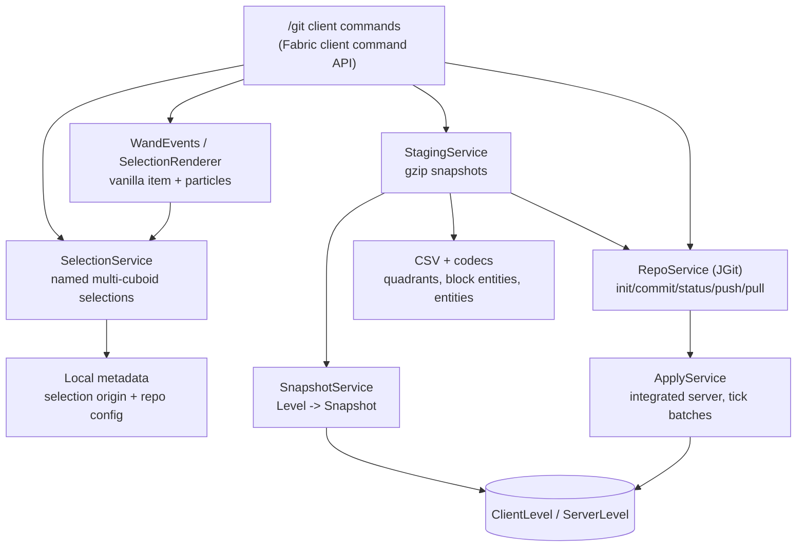

# Git Mod — Client-Side Implementation Plan

Derived from the server plugin plan ([Git Plugin Implementation Plan.md](Git%20Plugin%20Implementation%20Plan.md))
and [Git Minecraft Plugin Thoughts.md](Git%20Minecraft%20Plugin%20Thoughts.md). The mod keeps the
plugin's data format, repository layout, and user workflow, but replaces every Bukkit/server-side
assumption with a Fabric client-side equivalent.

> **Status — 2026-10-24:** Phases M0–M8 are implemented on feature branches and merged into the
> local `develop` branch. M9 (documentation, dev log, final verification) is in progress. The
> automated suite, the remapped jar contents (nested JGit/JavaEWAH), and a client startup smoke
> test pass; the single-player apply/round-trip checklist still needs a windowed manual run.

## 1. What changes when Git moves to the client

The plugin is authoritative: it can read any loaded chunk, write blocks, and register server
commands. A client mod can only use what the client knows, and can only change the world when the
player is hosting it (single-player / LAN host with an integrated server). The mod therefore has
two modes:

| Capability | Single-player (integrated server) | Multiplayer |
|---|---|---|
| Selections + wand | yes | yes |
| Capture blocks/entities | integrated server, full loaded world | client chunks only |
| Commit / staging / status | yes (capture may load chunks) | yes, but only client-loaded chunks |
| Repo / remote / push / fetch | yes | yes |
| Apply / pull / checkout | yes, on the integrated server | **not supported** (read-only message) |
| Pre-apply backup + `--abort` | yes | n/a |

No server plugin, server permission, or server command is required. Commands are registered with
Fabric's client command API, so `/git ...` is executed locally and does not need operator status.

### Non-goals in v1

- Server-authoritative multiplayer editing. Applying a build on a remote server would require a
  server-side companion mod or a packet protocol; v1 refuses and explains why.
- Branch UX, merge resolution (pull stays fast-forward-only), Litematica, lore labels, and
  training-data export. These remain Phase 9 in the plugin plan.
- Full parity for plugin commits that contain the plugin's typed block-entity JSON. Block states
  and entity rows still apply; unsupported block-entity payloads are skipped with a warning.

## 2. Guiding principles

1. **The repo format is shared.** Selection directories, quadrant CSVs, `entities.csv`,
   `meta.json`, commit messages, and the init commit intentionally match the plugin so a build can
   move between a Paper server and a client world.
2. **Relative coordinates are canonical.** Absolute coordinates live only in local selection
   metadata; commits always store origin-relative coordinates.
3. **Git is the storage engine.** JGit 6.10 is bundled; no external Git executable is needed.
4. **Thread rules are explicit.** Client state and `ClientLevel` access happen on the client thread.
   Integrated-server access happens on the server thread. JGit and file serialization happen on a
   worker executor; results are delivered back to the client thread.
5. **Never silently destroy a build.** Applying writes a gzipped pre-apply backup and refuses to
   run outside single-player. Out-of-range coordinates are reported and skipped, never clamped.
6. **Volumes are capped.** Selection, commit, entity, block-entity, status, and apply limits are
   configurable and enforced before work starts.

## 3. Architecture



### Package layout

```
org/almond/minecraftgit/
├── config/ModConfig.java                 # config.json, limits, paths
├── debug/DebugLogger.java                # optional per-session debug log
├── model/
│   ├── BlockPos, Cuboid, Selection
│   ├── BlockSnapshot, EntitySnapshot, Snapshot
│   └── BuildDiff
├── repo/
│   ├── RepoService.java                  # JGit facade
│   ├── RepoManager, RepoMetadataStore, RepoMetadata, RepoOptions
│   ├── RepoLocator, RepoInfo, CommitInfo, RemoteInfo, PullPlan, RepoProgress
│   └── CommitMeta.java                   # committed per-selection metadata
├── serialization/
│   ├── Quadrant, CsvLine, SnapshotCell
│   ├── QuadrantCsvWriter / QuadrantCsvReader
│   ├── BlockStateCodec.java              # BlockState <-> canonical string
│   ├── BlockEntityCodec.java             # SNBT payloads (nbt:...)
│   └── EntityCodec.java                  # entity SNBT payloads
├── staging/SnapshotStore, StagingService, StagedSelection
├── commit/CommitService, CommitRequest, CommitResult
├── status/StatusService
├── sync/PullService, PullException
├── world/
│   ├── SnapshotService.java              # capture from any Level
│   ├── CaptureResult
│   ├── ApplyPlan.java                    # pure write plan
│   └── BackupService.java
├── util/Names, Text, UserFacingException
└── client/                               # src/client only
    ├── MinecraftGitClient.java           # client entrypoint
    ├── GitServices.java                  # service graph + executors
    ├── WorldContext.java                 # world id, dimension, single-player flag
    ├── command/…                         # /git command tree
    ├── selection/WandEvents, SelectionRenderer, WandItem
    └── world/ApplyService.java           # integrated-server tick batches
```

`src/main` holds the shared model, serialization, repository, and staging code. It references
common Minecraft classes (`Level`, `BlockState`, `BlockEntity`, `Entity`) but no client-only
classes. `src/client` holds commands, world access, rendering, and initialization.

## 4. Storage and identity

All local state lives under `FabricLoader.getConfigDir()/minecraftgit/`:

| Data | Path |
|---|---|
| config | `config.json` |
| repositories | `repos/<worldId>/` |
| local repo metadata | `meta/<worldId>.json` |
| selections | `selections/<worldId>/<playerUuid>.json` |
| staging | `staging/<worldId>/<playerUuid>/<selection>.snap` |
| backups | `backups/<worldId>/<playerUuid>/<selection>/<timestamp>.snap` |
| temp | `tmp/` |
| debug logs | `logs/debug-<timestamp>.log` |

`worldId` is `<safeWorldName>__<dimensionPath>` (for example `world__overworld`). This keeps
Overworld/Nether/End repositories from sharing coordinates without changing the commit format.
In single-player `safeWorldName` comes from the integrated server's level name; in multiplayer it
combines the server display name with the server address so identically named servers stay
isolated. Selections always name one worldId.

## 5. Phase plan (adapted to the client)

### Phase M0 — Bootstrap and client shell
**Status:** ✅ Implemented on `feature/bootstrap`. The remapped jar nests JGit and JavaEWAH; a
development client starts and logs both `JGit is available` and `Minecraft Git initialized`.

- Rebrand the template to Minecraft Git: package `org.almond.minecraftgit`, mod id `minecraftgit`,
  client-only metadata, no example item/mixin, no server entrypoint.
- Add JGit 6.10 + JavaEWAH as bundled dependencies (`include`); confirm the remapped jar nests
  them and that Fabric Loader can see JGit.
- Add `ModConfig` (JSON under the config directory), `DebugLogger`, `Names`, and a `GitServices`
  service graph.
- Register a client `/git` command tree with help and config/debug basics. Proving that Fabric's
  client command API and JGit classes load is the phase gate.
- Keep dev-log tooling and CI; rewrite README/DEVOPS for the mod.

**Done when:** the mod builds, the client initializer runs, `/git help` works, and JGit loads.

### Phase M1 — Repo lifecycle and commands
**Status:** ✅ Implemented on `feature/repo-lifecycle`. JGit integration tests cover init, workspace
commits, push to a bare remote, fetch, and fast-forward planning.

- Port `RepoService` (JGit facade), `RepoManager`, `RepoMetadata`, `RepoMetadataStore`,
  `RepoLocator`, `RepoOptions`, and `CommitMeta` from the plugin, replacing plugin paths with
  `configDir/minecraftgit` and `World` with worldId strings.
- Commands: `init`, `repo`, `config author`, `config show`, `remote add|remove|list`, `log`,
  `push`, `fetch`.
- All Git work runs on the IO executor; command feedback returns to the client thread. Errors are
  single actionable chat lines.
- JGit integration tests: init, initial commit, workspace commit, remote add, push to a bare
  repo, fetch, and fast-forward classification.

**Done when:** `/git init` creates a repo and `/git push` moves a commit to a local bare repo.

### Phase M2 — Selections and the wand
**Status:** ✅ Implemented on `feature/selection`. Selection metadata and cuboid ordering are tested;
the wand uses vanilla custom data and returns `InteractionResult.FAIL` so no packet is sent.

- Port `BlockPos`, `Cuboid`, `Selection`, `SelectionMetadataStore`, and `SelectionService` with a
  worldId instead of a Bukkit world.
- Wand: a vanilla configurable item (default wooden shovel) tagged with custom data through
  `DataComponents.CUSTOM_DATA`; left-click = corner A, right-click = corner B. `ActionResult.FAIL`
  is returned client-side so the client does not send break/use packets to the server.
- Selection commands: `create`, `list`, `select`, `show`, `add`, `remove`, `reorigin`, `delete`,
  `wand`, `pos1`, `pos2`, `info`.
- Particle preview on a budget, from `ClientTickEvents`.
- Per-player, per-world persistence; active selection remembered in local repo metadata.

**Done when:** a player can build a multi-cuboid selection, restart the game, and still see it.

### Phase M3 — Capture and serialization
**Status:** ✅ Implemented on `feature/snapshot`. CSV/model tests pass for all quadrants, sparse
coordinates, tracked air vs empty, entities, and block-entity payloads. **Deviation:** block
entities use native SNBT (`nbt:` prefix) rather than the plugin's typed JSON, and multiplayer
capture can only see client-loaded chunks.

- Port `Snapshot`, `BlockSnapshot`, `EntitySnapshot`, `CaptureResult`, and the quadrant CSV
  writer/reader. Keep the plugin's headers and cell layout byte-compatible.
- `BlockStateCodec`: canonical block id + sorted properties; registry-safe decode with air
  fallback.
- `BlockEntityCodec`: serialize full available NBT with `BlockEntity#saveWithFullMetadata` into
  SNBT, base64 it into the CSV cell with an `nbt:` prefix. Decode through `TagParser` and
  `BlockEntity#loadWithComponents`; plugin JSON payloads are recognized and skipped with a warning.
- `EntityCodec`: `Entity#saveWithoutId` SNBT + type id; apply uses `EntityType#loadEntityRecursive`.
- `SnapshotService.capture(Level, Selection)` on the owning thread; client levels skip unloaded
  chunks and warn, while the integrated server may load chunks as needed (same caps).
- Unit tests: negative coordinates, sparse gaps, air-vs-empty cells, block-entity payloads,
  entities, and a synthetic capture round-trip.

**Done when:** capture → write CSV → read back → diff is empty for a known test region.

### Phase M4 — Staging
**Status:** ✅ Implemented on `feature/staging`. Gzip snapshot round-trips, restrict-after-remove,
and reorigin rebasing are tested.

- Port `SnapshotStore` (gzip binary) and `StagingService`.
- `/git add [selection]` captures through the correct side (client or integrated server), writes
  the staged snapshot, and marks the selection tracked.
- `/git rm [selection]` untracks and deletes staging.
- Removing a cuboid trims the staged snapshot; `reorigin` rebases it.

**Done when:** add → remove a cuboid → add in one session commits the intended coordinate set.

### Phase M5 — Commit
**Status:** ✅ Implemented on `feature/commit`. Commit-service tests verify the CSV tree, metadata,
second-commit counts, unchanged staging rejection, and explicit empty commits.

- Port `BuildDiff`, `CommitRequest`, `CommitResult`, `CommitService`, and `CommitMeta`.
- Write `<selection>/y_<y>/<quadrant>.csv`, `entities.csv`, and `meta.json`; create one commit for
  all staged changes; record absolute origin, previous origin, and reorigined flag.
- Default message `<player>: <selection> - <n> blocks changed`; `MinecraftGit-Commit: v1` body.
- Clear staging only after a successful commit.

**Done when:** two commits show an intelligible `git log -p` diff, including a reorigin commit.

### Phase M6 — Status and diff
**Status:** ✅ Implemented on `feature/status`. Reports untracked/clean/dirty/staged counts and
coordinate samples; status capture is volume-capped. **Deviation:** no TTL capture cache yet.

- `StatusService` compares HEAD, staged snapshot, and a fresh capture using relative coordinates.
- `/git status` reports untracked/tracked/clean/dirty and added/changed/removed counts.
- `/git diff [selection]` shows counts plus a few sample coordinates.
- Status volume cap; failures for one selection do not abort the report.

**Done when:** status on a 3-cuboid selection reports correct counts after edits.

### Phase M7 — Sync planning
**Status:** ✅ Implemented on `feature/sync-apply`. Pull planning, export, and checkout preparation
are covered by real-repository tests.

- Port `PullPlan`, remote fetch/classification, pristine-init handling, and `PullService` tree
  export/read. Pull is fast-forward-only; divergence is refused with guidance.
- Push/fetch support local paths and anonymous HTTP. SSH remains unsupported (JGit SSH module not
  bundled).
- `/git pull` works in single-player; in multiplayer it fetches and reports that applying needs
  single-player. Branch movement happens only after a successful apply.

**Done when:** a build committed in world A is fetched and planned into world B.

### Phase M8 — Apply, checkout, backups
**Status:** ✅ Implemented on `feature/sync-apply`. `ApplyPlan` and `BackupService` are unit-tested;
`ApplyService` writes through the integrated server in tick batches. Partial pulls are refused when
the remote contains more than one selection because a fast-forward would desynchronize the branch
from the world. **Gap:** the full in-world apply/checkout/abort round trip remains a manual
checklist because this environment cannot join a world offline.

- `ApplyPlan` converts relative coordinates + local origin into absolute writes; moved origins
  remove the old copy and place the new one.
- `ApplyService` runs on the integrated server, writes in `apply.blocks-per-tick` batches, applies
  block entities and entities, and reports skipped/out-of-range coordinates.
- Pre-apply backup is captured on the server thread, stored off-thread, pruned to
  `apply.max-backups`; `/git pull --abort` restores the newest backup.
- `/git pull` auto-creates a local selection at the player position when the remote selection is
  new, adds remote cuboids if the local selection has none, applies, then fast-forwards.
- `/git checkout <commit> [selection]` applies an older tree without moving the branch.
- Multiplayer: explicit refusal before any world or branch mutation.

**Done when:** push from world A → pull into world B reproduces the build and re-capture diff = 0.

### Phase M9 — Documentation and verification
**Status:** ✅ Implemented on `feature/docs`. README/DEVOPS were rewritten, the format and test
documents were added, and the phase status/evidence table was updated. `clean build` passes with 64
tests, the remapped jar nests JGit/JavaEWAH, and the client starts with the mod initialized. The
manual in-world apply/round-trip checklist remains outstanding because this environment cannot
download assets or join a world offline.

### Implementation evidence

Each feature was developed in a worktree, squashed to one commit, and merged with `--no-ff` into
local `develop`; feature branch names are retained.

| Phase | Branch | Squashed commit | Merge |
|---|---|---|---|
| M0 | `feature/bootstrap` | `4345c4f` | `74bdf11` |
| M1 | `feature/repo-lifecycle` | `7bd104a` | `6f6de90` |
| M2 | `feature/selection` | `80d95cc` | `53782de` |
| M3 | `feature/snapshot` | `427d087` | `e3d1449` |
| M4 | `feature/staging` | `e937ee2` | `853b410` |
| M5 | `feature/commit` | `2a73d2d` | `c962a87` |
| M6 | `feature/status` | `836ba65` | `4f50914` |
| M7/M8 | `feature/sync-apply` | `30d49f0` | `f945262` |

M9 is documented on `feature/docs`; its squash/merge is the final step after verification.

Automated evidence: the JUnit suite runs from `./gradlew --offline test` (64 test methods in 17
suites, 0 failures), and `./gradlew --offline clean build` completes successfully. Jar evidence:
`minecraftgit-1.0.0.jar` contains
`META-INF/jars/org.eclipse.jgit-6.10.0.202406032230-r.jar` and `META-INF/jars/JavaEWAH-1.2.3.jar`,
and `fabric.mod.json` has the matching `jars` entries. Client evidence: `runClient` (with
`-x downloadAssets` because assets are unavailable offline) logged `JGit is available to Minecraft
Git` and `Minecraft Git initialized` with no mod-related errors. The 64-test suite also bootstraps
Minecraft's registries to round-trip real block states through `BlockStateCodec`.

## 6. Edge-case register (client-specific additions)

| # | Case | Handling |
|---|---|---|
| C1 | Multiplayer cannot write blocks | Refuse apply/pull/checkout with a single clear message; repo-only commands still work. |
| C2 | Client chunks not loaded | Capture skips them, counts them, and warns. Single-player captures through the integrated server instead. |
| C3 | Integrated server unavailable during shutdown/world change | Futures fail with a friendly message; no partial branch movement. |
| C4 | World identity differs from the plugin's world name | Use `<world>__<dimension>` locally and record it in `CommitMeta.world`; the repo tree itself is unaffected. |
| C5 | Player changes dimension | Each dimension has its own repo and selection metadata. |
| C6 | Client disconnect during async work | Completion callbacks check `Minecraft.getInstance().player`/level before touching state; results are dropped safely. |
| C7 | Block state property order | Sort properties by name so captures are reproducible. |
| C8 | Unknown/modded block state | Decode to air and warn; never abort an apply. |
| C9 | Block-entity NBT unavailable on the client | Capture what the client has; prefer the integrated server in single-player; cap payload bytes. |
| C10 | Plugin JSON block-entity payload | Detect `{` payloads that are not SNBT, skip with a warning; block data still applies. |
| C11 | Wand item in offhand / other hand | Only main-hand interactions are captured. |
| C12 | Wand clicks would break/place blocks | Return `InteractionResult.FAIL` client-side so no packet is sent. |
| C13 | Selection origin removed | Same as plugin E2: origin stays; reorigin is explicit. |
| C14 | Staged snapshot from another dimension | Staging is keyed by worldId; no cross-dimension reads. |
| C15 | JGit bundled-jar visibility | Verify the remapped jar nests JGit and JavaEWAH; add a startup log line. |

Plugin E1–E12 otherwise carry over unchanged (cuboid ordering, origin drift, tracked-air rules,
sparse CSV, volume caps, diverged pull refusal).

## 7. Decisions

| Question | Decision | Why |
|---|---|---|
| Where do repos live? | `<configDir>/minecraftgit/repos/<worldId>` | Outside the save folder, mirroring the plugin's plugin-data decision; world backups never capture a hot `.git`. |
| One repo per world or server? | One per worldId (world + dimension). | Matches plugin Q2 and avoids cross-dimension coordinates. Multi-repo grouping is later. |
| Git implementation | JGit 6.10, bundled with `include`. | No external Git binary, matches the plugin, works on Windows/macOS/Linux. |
| Client vs server commands | Fabric client commands. | No server installation or permissions; commands can run in any server. |
| World writes | Integrated server only, tick-batched. | Client-side block writes desync in multiplayer; single-player can be authoritative. |
| Capture source | Integrated server when available, otherwise client level. | Accuracy in single-player; graceful degradation in multiplayer. |
| Wand item | Vanilla item + custom data, no registry. | Works on any server; no server-side item sync. |
| Block-entity format | SNBT payload prefixed `nbt:`. | Full available NBT, unlike the plugin's typed Paper API subset. CSV layout stays the same; plugin payloads are skipped, not misapplied. |
| Checkout semantics | Materialize an old commit; do not move HEAD. | Matches plugin Q6 and builder expectations. |
| Pull merge | Fast-forward only. | Same as v1 plugin; coordinate merge is a later milestone. |

## 8. Testing strategy

- Pure-JVM JUnit tests for model math, quadrant CSV round-trips, block/entity payload encoding,
  `BuildDiff`, `CommitMeta`, `SnapshotStore`, and JGit repo lifecycle (init/commit/remote/push/
  fetch/pull classification).
- `./gradlew build` at every phase; inspect `build/libs/minecraftgit-*.jar` for `fabric.mod.json`,
  nested JGit/JavaEWAH jars, and no example classes.
- Client smoke test via `./gradlew runClient` when a window is available: `/git help`,
  `/git init`, `/git selection create`, wand clicks, `/git add`, `/git commit`, `/git status`.
- Manual two-world round trip in single-player: build, select, add, commit, copy/push repo, pull
  into a second world, re-capture and confirm zero diff. Documented in `Documentation/Testing.md`.
