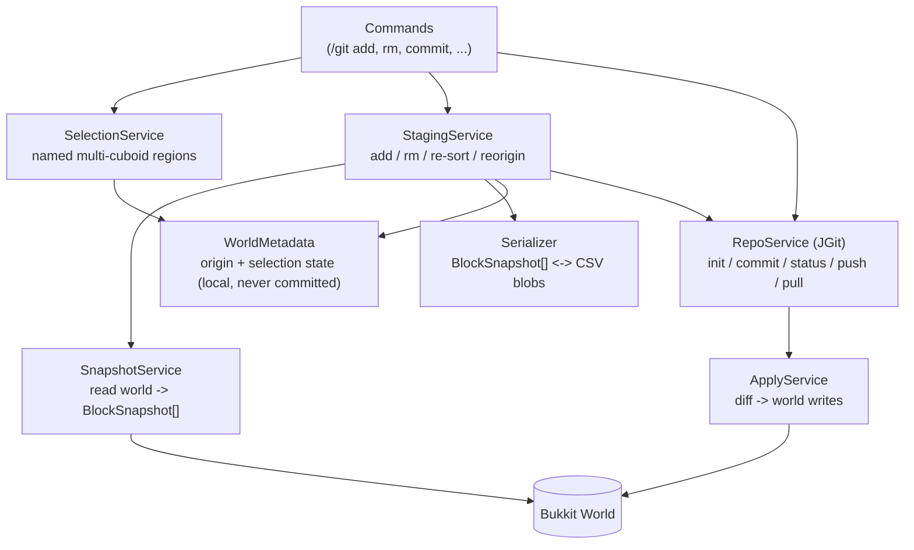

# Git Plugin — Implementation Plan

Derived from [Git Minecraft Plugin Thoughts.md](Git%20Minecraft%20Plugin%20Thoughts.md).
This document turns those thoughts into an ordered build plan: what to build, in what order,
which classes own which responsibility, and which edge cases must be handled before we call a phase done.

> **Implementation status — 2026-10-23:** Phases 0–8 are implemented on feature branches and merged
> into the local `develop` branch. The shaded jar loads on Paper **1.21.4 build 232**; a real-server
> smoke test exercised `/git help`, `/git init world`, and `/git repo world` successfully. Phase 9
> (Litematica, lore labels, training-data export, client mod) remains deliberately deferred.
> See [§7](#7-implementation-decisions-resolving-6) for decisions, [§8](#8-known-limitations-and-follow-ups)
> for limitations, and [§9](#9-implementation-and-test-evidence) for evidence.

## 0. Intent & scope

We are **not** re-implementing Git. We are wrapping it (JGit) so that a Minecraft build region can be
treated like a file tree.

| Priority | Use case |
|---|---|
| Primary | Move builds between locations and between people. |
| Secondary | Version control & history — revert changes, keep multiple variations of a build. |
| Long term | Collect build/lore/lands data as training data for valuation, taxation, development level, and fair district division. |

**In scope (v1):** selection → add/rm → commit → status → push/pull, relative-coordinate storage,
CSV serialization of blocks + block entities.
**Out of scope (v1):** merge conflict resolution, branching UX, Litematica import/export, lore labels, client-side mod.
**Non-goal:** server-side Git hosting. Remotes are user-supplied (file path, HTTP, SSH).

## 1. Guiding principles

1. **Git is the storage engine.** Every design decision should be expressible through JGit's object
   model (blobs, trees, commits, refs). If we can't say it in Git terms, we are over-engineering.
2. **The world is always the source of truth.** A commit captures a snapshot; a pull *applies* a diff.
   Nothing in the working tree remembers state that the world doesn't have.
3. **Main-thread block access only.** All `World#getBlockData` / `setBlockData` calls happen on the
   server thread. Serialization of an already-captured snapshot may be async.
4. **Selections are durable, named, and local.** A selection is a first-class object persisted per-world,
   not an in-memory session.
5. **Relative coordinates are a view, never the truth.** Absolute coordinates live in local metadata;
   relative coordinates live in the repo.

## 2. Architecture overview



### Implemented package layout

```
org/almond/minecraftgit/
├── GitPlugin.java                    # JavaPlugin wiring, lifecycle, bounded worker pool
├── backup/
│   └── BackupService.java            # pre-apply snapshots, pruning, latest-backup lookup
├── command/
│   ├── CommandManager.java           # /git dispatch + tab completion
│   ├── SubCommand.java / CommandSupport.java / CommandException.java
│   ├── GitInit, GitRepoInfo, GitConfigCommand, GitRemoteCommand, GitLogCommand
│   ├── GitSelectionCommand, GitAdd, GitRm, GitCommit, GitStatus, GitDiff
│   ├── GitPull, GitCheckout, GitPushCommand, GitFetchCommand
│   ├── GitDebug, GitHelp, GitReload
│   └── ActionBarProgress.java        # JGit progress -> throttled action bar
├── commit/
│   ├── CommitService.java            # staging -> CSV tree -> JGit commit
│   ├── CommitRequest.java / CommitResult.java / CommitException.java
├── config/PluginConfig.java          # typed config.yml view
├── debug/DebugLogger.java            # per-session world/repo debug log
├── message/Messages.java             # defaults + config overrides
├── model/
│   ├── BlockPos, Cuboid              # coordinate math + smallest-corner ordering
│   ├── Selection                     # name, owner, cuboids, origin, tracked flag
│   ├── BlockSnapshot, EntitySnapshot, Snapshot
│   └── BuildDiff                     # canonical relative-coordinate diff
├── repo/
│   ├── RepoService.java              # JGit facade, workspace commits, pull plan/export
│   ├── RepoManager / RepoLocator / RepoMetadataStore / RepoMetadata
│   ├── RepoOptions, RepoInfo, CommitInfo, RemoteInfo, PullPlan, RepoProgress
│   └── CommitMeta.java               # committed per-selection meta.json
├── selection/
│   ├── SelectionService.java         # durable per-world+player selection CRUD
│   ├── SelectionMetadataStore.java   # JSON, never committed
│   ├── SelectionManager.java         # per-player wand corners + active selection
│   ├── SelectionListener.java        # left/right wand click handling
│   ├── SelectionRenderer.java        # particle outline with hard budget
│   └── WandItem.java                 # PDC-tagged configurable item
├── serialization/
│   ├── QuadrantCsvWriter / QuadrantCsvReader
│   ├── Quadrant, CsvLine, SnapshotCell
│   ├── BlockEntityCodec.java         # typed BlockState data <-> JSON
│   └── SnapshotCodec.java            # safe BlockData string decoding
├── staging/
│   ├── StagingService.java           # /git add, /git rm, reorigin/rm rebasing
│   ├── SnapshotStore.java            # gzipped binary staging + backup format
│   └── StagedSelection.java
├── status/
│   ├── StatusService.java            # HEAD vs staged vs current, /git diff
│   ├── SnapshotCache.java            # TTL capture cache
│   └── SnapshotCacheListener.java    # invalidate on block edits
├── sync/
│   ├── PullService.java              # export remote tree -> ApplyPlan inputs
│   └── PullException.java
├── world/
│   ├── SnapshotService.java          # main-thread capture + coordinate backup capture
│   ├── ApplyService.java             # chunk preload + budgeted writes + entities
│   ├── ApplyPlan.java                # canonical relative -> absolute world writes
│   └── CaptureResult / ApplyResult / ApplyException
└── util/Names, Text, UserFacingException
```

## 3. Phase plan

Each phase ends with a working, testable increment. Phases 1–3 are the foundation; 4–8 are the
user-visible Git workflow; 9+ is where the long-term goals attach.

### Phase 0 — Bootstrap & de-templating
**Goal:** the plugin actually loads as *our* plugin.

**Status:** ✅ Implemented on `feature/bootstrap`. Paper 1.21.4 smoke test confirms the shaded JAR
bundles JGit and the plugin enables cleanly.

- [x] Fix `src/main/resources/plugin.yml` → `name: MinecraftGitPlugin`, `main: org.almond.minecraftgit.GitPlugin`, real author/description, `api-version: '1.21'`, `/git` command + `minecraftgit.command.*` permissions.
- [x] Delete/replace `com/example/minecrafttemplateplugin/TemplatePlugin.java`.
- [x] `GitPlugin` gains: `PluginConfig`, command registration, a bounded async executor, and a `RepoService` held as a singleton field.
- [x] Add a `minecraftgit.debug` flag that logs every world read/write to a per-session file (invaluable for coord bugs).
- [x] Confirm the Shadow JAR bundles JGit and loads on the target Paper version.

**Done when:** `/git` responds with usage text on a clean server.

### Phase 1 — Repo lifecycle
**Goal:** a world can have a Git repository, without any build data yet.

**Status:** ✅ Implemented on `feature/repo-lifecycle`. `RepoService.init` creates a non-bare repo with a
format README and `.gitattributes`; `RepoManager`/`RepoLocator`/`RepoMetadataStore` own per-world state;
remote add/list/remove, config author, log, fetch, push, and empty commits are covered by JGit integration tests.

- `RepoService.init(world)` → JGit `Git.init()` at the configured path.
- `RepoLocator` decision — **open question Q1** (see §6). Default assumption: `<plugin data>/repos/<worldName>/`,
  outside the world folder, so server-side world backups don't tangle with `.git`.
- `RepoService.remote(...)`, `RepoService.config(user.name, user.email)` — required before the first commit,
  otherwise JGit refuses to commit.
- `commit()` / `push()` / `pull()` thin wrappers with structured result types (never throw raw JGit exceptions at the command layer).
- Per-world `RepoMetadata` file mapping plugin concepts → Git concepts, e.g. which branch is "the main line".
- All repo I/O runs off the main thread; commands return a `CompletableFuture` and reply to the sender on completion.

**Done when:** `/git init` creates a repo, `/git remote add origin <path>` works, `/git push` pushes an empty commit to a local bare repo.

### Phase 2 — Selection subsystem
**Goal:** the user can define the thing that gets versioned.

**Status:** ✅ Implemented on `feature/selection`. Named multi-cuboid selections are persisted per
world + player under `plugins/MinecraftGitPlugin/selections/`; the PDC-tagged wand appends boxes;
`show` renders a budgeted particle preview; add/remove/re-sort/reorigin are covered by model tests.

- Wand item (configurable, default `WOODEN_SHOVEL`) with left-click = corner A, right-click = corner B → creates a `Cuboid`.
- Selecting again (with a name set) **appends** a new cuboid to the same named selection — the thoughts are explicit that our land selection is a *set* of cuboids, not one box.
- `/git selection create <name>`, `/git selection list`, `/git selection show`, `/git selection delete <name>`.
- Cuboids are kept **sorted by smallest absolute corner coordinate** on every add/remove (see §4, E1).
- Region preview via particles on `show`.
- `SelectionMetadataStore` persists the selection list (name, cuboids, origin, owner) locally per world+player.
  **This file is never committed** — it is machine-local working state.

**Done when:** a player can build a multi-cuboid selection, disconnect, reconnect, and `/git selection show` still renders it correctly.

### Phase 3 — Snapshot & serialization
**Goal:** a selection becomes bytes in a committed blob.

**Status:** ✅ Implemented on `feature/snapshot`. `SnapshotService` captures blocks, typed block-entity
state, and entities on the main thread. Quadrant CSV round-trips are covered by 7 tests including
negative coordinates, sparse gaps, empty cells vs air, entities, and block-entity payloads.
**Deviation:** the Paper API does not expose full vanilla NBT, so `BlockEntityCodec` stores the typed state
that *is* public (inventory, sign sides, banners, skull owner, spawner, jukebox, lectern, beacon, furnace/
brewing timers, beehive, command/structure block, end gateway). See §8.

- `SnapshotService.capture(selection)` walks each cuboid on the main thread, producing `BlockSnapshot`s with:
  - absolute coordinates (world space),
  - relative coordinates (absolute − origin),
  - `blockData.getAsString()` (carries block type, facing/orientation, waterlogged, and most states),
  - serialized block-entity NBT where present (chests, signs, banners, spawners…),
  - a stable sort order for reproducible output.
- Entities (item frames, armor stands, paintings, mobs) captured by `EntitySnapshot` — same relative-coordinate treatment.
- **Missing coordinates are meaningful.** "Air is not the same as untracked" — an untracked coordinate produces no line at all; a tracked coordinate that is air produces a line saying air. This distinction is what makes `rm` work.
- Serialization format: **4 CSV files per Y level, one per quadrant** (as decided in the thoughts doc).
  - Path scheme: `<selection>/y_<y>/<quadrant>.csv` where quadrant ∈ `{pp, pn, np, nn}` (sign of x, sign of z).
  - Each line = one `x` row; columns = `z`. Both run from the quadrant boundary toward +∞ / −∞ respectively, so the origin is at the corner shared by all four files.
  - A **header line** records the format version, origin, and the y level, so a reader can jump straight to the origin's file/row/column instead of scanning.
  - Empty runs may later be collapsed with a run-length token (`*N` = N air/absent columns) if size becomes a problem — **defer**, but keep the format versioned so it is a non-breaking change.
- `SnapshotCodec` round-trip: `BlockData` → string → `BlockData` must be lossless; use a registry-safe `createBlockData(String)` and a fallback for unknown/unloaded modded states.
- Unit tests (pure JVM, no server): round-trip a synthetic 3D volume incl. negative coordinates, empty cuboids, and sparse gaps.

**Done when:** capture → write to blob → read back → compare produces a zero diff on a test region.

### Phase 4 — Staging: add / rm
**Goal:** the working tree reflects the player's intent.

**Status:** ✅ Implemented on `feature/staging`. Staged snapshots are gzipped binary files under
`plugins/MinecraftGitPlugin/staging/<world>/<uuid>/<selection>.snap`; `/git add` marks tracked,
`/git rm` untracks, and cuboid removal/reorigin trim or rebase the staged copy. `SnapshotStore` round-trip
and truncation tests pass.

- `/git add <selection>` — stages the capture. Staging means: the selection is marked tracked and its snapshot is held/diffed against `HEAD`.
- `/git rm <selection>` — untracks. Per the thoughts: for most coordinates this is trivial; the interesting
  cases are the origin coordinate and successive removals of the smallest coordinates (§4, E2/E3).
- Renumbering is automatic: whenever a cuboid is added or removed, re-sort by smallest corner.
- **Origin re-adjust** (`/git selection reorigin`): rebase all relative coordinates so the smallest live
  coordinate becomes the new `0,0,0`. In a normal commit this is recorded as a metadata field — the new
  absolute origin — so a pull can shift before applying (E4). This is the safety valve that makes malicious
  or accidental origin drift a non-issue.
- Staging state is persisted locally so it survives server restarts.

**Done when:** add → rm → add in a single session produces a consistent tree, including after removing the origin cuboid.

### Phase 5 — Commit
**Goal:** write the change set into Git.

**Status:** ✅ Implemented on `feature/commit`. `CommitService` writes `<selection>/y_<y>/<quadrant>.csv`
plus `<selection>/meta.json`, creates one commit for all staged changed selections, records absolute
origin/previous origin/reorigin state, and clears the local index. Commit-meta and workspace-commit tests pass.

- `BuildDiff` computation: compare staged snapshots against the previous commit's tree for the same selection.
  - **Merge semantics** (from the thoughts): the *final* state of each coordinate wins. The commit records
    modify data for the whole build as the set of cuboids with relative coordinates, each carrying its block data.
  - Removed coordinates become real file/row removals; added ones become insertions.
- `CommitMeta` (in the commit message body, or a `.meta.json` blob) carries:
  - selection name, dimensions, cuboid count,
  - **absolute origin** at commit time,
  - "reorigined: true/false" + previous origin if the origin moved,
  - format version, plugin version, author, world/Gamemode context.
- Commit message default: `<player>: <selection> — <n> blocks changed` with an override flag.
- Never block the server thread: snapshot on main, diff + write off main.

**Done when:** two commits on the same selection, then `git log -p` on the bare repo, shows an intelligible diff.

### Phase 6 — Status
**Goal:** the user can see what would change.

**Status:** ✅ Implemented on `feature/status`. `/git status` and `/git diff` compare canonical relative
coordinates across HEAD, the staged snapshot, and a current capture. Captures are cached with a TTL and
invalidated by break/place/explosion/piston/flow/sign etc. events; huge selections honor the configurable
status volume cap instead of hanging the server.

- `/git status` — untracked selections, staged (added/changed/removed coordinate counts), clean vs dirty.
- Cheap path: compare "capture now" vs "last commit" per tracked selection. Expensive on large builds —
  cache the captured snapshot with a TTL and invalidate on `BlockChangeEvent` inside a tracked selection.
- `/git diff <selection>` — summary + optional count of changed coordinates, plus a spot-check sample.

**Done when:** `/git status` on a 3-cuboid selection reports correct add/change/delete counts.

### Phase 7 — Sync: remote / push / pull / fetch
**Goal:** move builds between people and locations.

**Status:** ✅ Implemented on `feature/sync`. Remote add/remove/list, fetch, push, fetch progress
(action bar), pull planning, fast-forward, and commit-tree export are in place. `RepoPullTest` proves a
fresh world pulls an unrelated-init repository and that divergence is detected rather than overwritten.
**v1 scope:** pull is fast-forward-only; diverged histories are reported with guidance, not merged.

- `/git remote add|remove|list`, `/git fetch`, `/git push [--force]`, `/git pull`.
- Credentials: v1 supports local paths and anonymous HTTP. SSH requires adding the optional
  `org.eclipse.jgit.ssh.apache` dependency (already commented in `build.gradle`) — track as a follow-up.
- Progress reporting for long operations (JGit `ProgressMonitor` → action-bar/boss-bar).
- Authentication failures surface as actionable chat errors, never stack traces.

**Done when:** a build pushed from world A is cloned/pulled into world B.

### Phase 8 — Apply / pull into a world
**Goal:** the round trip closes.

**Status:** ✅ Implemented on `feature/apply`. `/git pull` auto-creates a local selection when needed,
loads chunks asynchronously, writes a pre-apply backup, applies blocks in deterministic tick batches,
restores entities, then fast-forwards the local branch. `/git pull --abort` restores the latest backup;
`/git checkout <commit>` materializes an older commit into the current selection. `ApplyPlan` covers
same-origin diffs, moved origins, and backup restore. Paper smoke test verifies the plugin initializes
on 1.21.4; full in-world round-trip still needs a player-driven manual test (§8/§9).

```mermaid
sequenceDiagram
    participant P as Player
    participant R as RepoService
    participant M as RepoMetadata
    participant A as ApplyService
    participant W as World
    P->>R: /git pull <selection>
    R->>R: fetch + classify (v1: fast-forward only; divergence refused)
    R->>M: read commit origin + local origin
    M-->>R: delta
    R->>A: apply(relative coords, delta)
    A->>W: setBlockData for each changed coordinate
    A-->>P: applied n blocks, skipped m (unloaded / out of world)
```

- Convert relative → absolute by adding the local origin, plus the origin delta from `CommitMeta` (E4).
- **Y-range & world bounds:** Minecraft 1.21 is `-64..319`. Coordinates outside the target world's range are
  reported and skipped, not silently clamped.
- **Chunk loading:** load target chunks (or require them loaded) before writing; do not force-load the
  entire selection and stall the server — batch writes across ticks with a configurable blocks-per-tick budget.
- **Ordering:** removals and placements must be applied in a deterministic order so overlapping
  multi-cuboid selections land in the intended state.
- **Undo:** keep a local "pre-pull" snapshot so `/git pull --abort` / `/git checkout` can restore. Without
  this, a bad pull is unrecoverable and users will not trust the plugin.
- `/git checkout <commit>` — materialize an older commit into the world using the same ApplyService path.

**Done when:** push from world A → pull into world B reproduces the build exactly (verified by re-capture and diff = 0).

### Phase 9 — Long-term / experimental
**Status:** ⏸️ Deferred by design; Phases 0–8 are the v1 scope. The format and package layout leave
room for these (versioned CSV, `CommitMeta.relativeCuboids`, `SnapshotService`/`ApplyService` split).

Only start these once Phases 0–8 are stable.

- **Litematica compatibility:** import/export `.litematic` so builds are useful in survival. Our CSV layer
  becomes one of several `SnapshotCodec` implementations; the interface should be designed with this in mind from Phase 3.
- **Labels / describers:** consume the Building-Lore linking plugin's `describer + min/max cuboid regions`.
  Do **not** repeat a describer on every block. Instead store regions in commit metadata and, at training
  time, resolve a coordinate → region → describer. Constrain to a finite label set so a classifier is feasible
  even when two labels are semantically identical.
- **Training-data export:** a `training-data` command that streams commit history into a dataset
  (build + lore + lands) for valuation/taxation/district-division models.
- **Client-side mod** (mirrors the plugin, downloads a portable Git or uses a Java Git library — the thoughts
  list both options; prefer the pure-Java route so no external binary is required).

## 4. Edge-case register

| # | Case | Handling |
|---|---|---|
| E1 | Cuboid order is load-bearing | Re-sort the cuboid list by smallest absolute corner on every add/remove. Never rely on insertion order. |
| E2 | Player deletes the starting coordinate | The `0,0,0` coordinate is *abstractly* still represented — remaining blocks reference it. Keep the origin where it is; no cuboid is required to contain it. |
| E3 | Player repeatedly deletes smallest coordinates | The selection drifts far from the origin. Harmless for correctness (relative math still works), so allow it — offer reorigin rather than forcing it. |
| E4 | Origin moved between pull and push | `CommitMeta` records the absolute origin plus previous origin/reorigined flag. Commits store canonical relative coordinates; apply places at `localOrigin + relative`, so a build pulled from another world lands where the local selection says. |
| E5 | Malicious / adversarial selections | Config caps cuboid count, selection volume, commit blocks, entity count, block-entity/entity payload bytes, status volume, and apply chunks. Rejection messages name the limit. |
| E6 | Coordinate removed vs coordinate set to air | Tracked-and-air emits a CSV cell (`minecraft:air`); untracked emits an empty cell. `/git selection remove` trims the staged snapshot; `/git rm` removes staging. |
| E7 | Sparse / far-apart coordinates in a quadrant CSV | Accepted in v1; the format version in every header leaves room for RLE. |
| E8 | Block entity NBT (chests, signs) | Typed Paper API state is serialized to versioned JSON and capped by `limits.max-block-entity-bytes`; unsupported vanilla-only NBT is not captured (see §8). |
| E9 | Entities at the selection boundary | Captured by bounding-box overlap; apply removes old entities by type + position and then spawns the target payload. Pre-apply backups currently store blocks/block entities, not entities (see §8). |
| E10 | Unloaded chunks during capture/apply | Capture skips unloaded chunks, counts them, and warns; staging still succeeds. Apply preloads chunks in configured batches before writing. |
| E11 | Out-of-range Y after an origin shift | Reported as a warning and skipped; never clamped. |
| E12 | Two players editing the same selection | Selection metadata is per world + player; the repo is the merge point. v1 pull only fast-forwards and reports divergence rather than merging; last committed tree wins. |

## 5. Testing strategy

- **Pure-JVM unit tests** (no server): `Cuboid` ordering, relative/absolute conversion incl. negative
  coordinates, CSV quadrant round-trip, `SnapshotCodec` losslessness, `BuildDiff` merge semantics,
  origin-shift math, E2/E3/E4 scenarios.
- **Mocked-Bukkit tests** for `SnapshotService` / `ApplyService` where practical.
- **Integration, manual on `/run`:** build a known structure, commit, mutate, status, pull back, verify.
  Keep a small "golden save" world for this.
- Every phase boundary needs a dev-log entry; the existing `Utils/dev-log-generator` flow already produces them.

**Actual v1 result:** 59 pure-JVM test methods across 20 suites, 0 failures (Maven-style JUnit
results). Real JGit integration tests cover init/commit/push/fetch/pull/divergence/tree export. A Paper
1.21.4 build 232 smoke test verified plugin enable, `/git help`, `/git init world`, `/git repo world`,
and clean shutdown. MockBukkit/world-apply tests are still a gap; the two-world player-driven round trip
is documented as a manual checklist in `Documentation/Testing.md`.

## 6. Open questions

- **Q1 — Where does `.git` live?** Inside the world folder (travels with the map, but bloats world backups
  and risks corruption on save) or in the plugin data folder keyed by world name (cleaner, but the repo is
  no longer self-contained). Current plan assumes the plugin data folder; revisit if portability wins.
- **Q2 — One repo per world or one repo per server?** Per-world matches the `RepoLocator` design; per-server
  makes cross-world builds a `git checkout` away. Per-world is the safer default.
- **Q3 — Quadrant naming and the y-level file layout** are settled, but should a *single* selection ever span
  multiple worlds/dimensions (Nether ↔ Overworld)? If yes, the repo tree needs a dimension dimension.
- **Q4 — How does `GitMinecraft : Git` (from the thoughts' class diagram) map onto our command classes?**
  The diagram implies a shared base with `add/rm/commit/status/push/pull/init/remote/config/checkout`.
  Suggest: an abstract `GitCommandGroup` holding the JGit-facing methods, subclassed by the Minecraft-specific
  command group — worth confirming before Phase 1 so the command layer isn't rewritten later.
- **Q5 — Compression/limits.** Real megabuilds are millions of coordinates. What's the hard volume cap for v1,
  and do we let JGit's own compression handle blob size or pre-pack with gzip?
- **Q6 — Does `checkout` mean "restore world blocks" or "checkout a branch"?** The thoughts list `checkout()`
  as a Git operation; for a Minecraft user the intuitive meaning is "put this build back in my world",
  which is what Phase 8 implements. Confirm the intended semantics.

## 7. Implementation decisions (resolving §6)

| Question | Decision in v1 | Why |
|---|---|---|
| Q1 — where does `.git` live? | `<plugin data>/repos/<world>/`, outside the world folder. | World backups never capture a hot `.git`; server plugins can safely back up the world. The trade-off is that repositories are not self-contained, so they must be copied with the plugin data folder. |
| Q2 — one repo per world or server? | **Per world.** | Matches `RepoLocator`, prevents accidental cross-dimension coordinates, and keeps one bad selection from blocking all worlds. Multi-repo/nation repositories stay a Phase 9+ idea. |
| Q3 — cross-dimension selections | Not in v1. `CommitMeta.world` records the dimension; a selection cannot span worlds. | Avoids adding a dimension segment to every repo path. Can be added as `<selection>/<dimension>/…` with a format-version bump. |
| Q4 — `GitMinecraft : Git` class diagram | Replaced by a composition-based `CommandManager` + `SubCommand` set; JGit lives in `RepoService`. | The inheritance in the thoughts diagram would expose Git concepts to command code. The facade keeps all JGit exceptions, locking, and path safety in one layer. |
| Q5 — compression/limits | CSV blobs are left to JGit's zlib compression. Default caps: 64 cuboids, 1M selection blocks, 2M commit blocks, 2k entities, 256 KiB block-entity payload, 250k status blocks. | Simple and safe; megabuilds need a later streaming/export path. |
| Q6 — `checkout` semantics | **Restore world blocks.** `/git checkout <commit>` materializes an older commit into the current selection and leaves the branch/HEAD alone. | Matches the builder's mental model; branch checkout is not a v1 feature. |

Additional decisions made during implementation:

- **Command-layer errors never expose raw JGit.** `UserFacingException` subclasses (`RepoException`,
  `StagingException`, `CommitException`, `ApplyException`, `PullException`, `SelectionException`) are shown
  as one chat line; unexpected failures are logged and summarized.
- **Relative coordinates are canonical.** Status, diff, and commit compare `byRelative()` maps directly.
  This is what lets a build pulled from another world compare clean; absolute positions are only used when
  writing the world.
- **Staging and backups use a binary gzip format**, not CSV. They are machine-local and potentially large;
  the commit format stays human-readable CSV.
- **A pull into a fresh world is treated as an unborn branch.** `/git init` creates a README scaffold, so
  the naive history comparison would call the two worlds unrelated. `RepoService.planPull` recognizes a
  pristine init commit (only README/.gitattributes) and fast-forwards over it; a world with build commits is
  still reported as diverged.
- **Pull auto-creates the local selection.** If the remote selection does not exist locally, the plugin
  creates it at the player's block position, copies the remote cuboids relativized to that origin, and
  applies the build there. That removes a confusing "create an empty selection first" step.
- **Pre-apply backups are always written** unless restoring a backup. `/git pull --abort` restores the
  newest backup for a selection; backups are pruned to `apply.max-backups`.

## 8. Known limitations and follow-ups

1. **No full vanilla NBT.** Paper's public API exposes typed `BlockState` data, not arbitrary NBT.
   `BlockEntityCodec` covers inventories (all containers), both sign sides, banner patterns, skull owner,
   spawner settings, jukebox records, lectern page/inventory, beacon effects, furnace/brewing timers,
   beehive capacities, command blocks, structure blocks, and end gateways. Modded/custom NBT and
   unsupported tile entities are not round-tripped. A future `paperweight`/NMS module or a Paper API
   addition could fill this.
2. **Entity backups are incomplete.** Pre-apply backups capture blocks and block entities, so
   `/git pull --abort` restores terrain/containers but not entities spawned or removed by the pull.
   Entities themselves are captured/applied for commits; duplicate UUID handling depends on Paper's
   `EntitySnapshot` behavior and should be tested with item frames/armor stands.
3. **Pull is fast-forward-only.** Diverged histories are detected and refused; coordinate-level merge
   ("final state wins") is designed but not enabled. This is the main Phase 7/8 follow-up.
4. **Pulling into an existing selection keeps its cuboids.** Only selections with zero cuboids receive
   the remote cuboids automatically. If the remote build extends outside the local cuboids, status/commit
   will not track the extra blocks; users should grow the local selection. A future pull could offer a
   `--replace-cuboids` flag.
5. **Capture and backup are still main-thread operations.** They are volume-capped, but a very large
   selection can still cause a noticeable tick spike. Chunked capture across ticks is the next performance
   step.
6. **SSH remotes** need `org.eclipse.jgit.ssh.apache` (already noted/commentable in `build.gradle`).
   v1 supports local paths and anonymous HTTP; credentials embedded in HTTPS URLs work but are not stored
   by the plugin.
7. **No branch UX, Litematica import/export, lore labels, training-data export, or client mod** — all
   Phase 9.
8. **Selection metadata is per player.** Two players editing the same named selection keep separate
   local metalists; the repository is the only shared state. v1 has no conflict warning beyond the
   diverged-pull refusal.

## 9. Implementation and test evidence

### Branches merged into local `develop`

| Phase | Branch | Squashed commit |
|---|---|---|
| 0 | `feature/bootstrap` | Bootstrap MinecraftGit plugin: config, debug logging, command framework |
| 1 | `feature/repo-lifecycle` | Add JGit repository lifecycle, metadata, remotes, config, log, push and fetch |
| 2 | `feature/selection` | Add named multi-cuboid selections, wand, metadata persistence and previews |
| 3 | `feature/snapshot` | Add snapshot capture, quadrant CSV format, block-entity and entity codecs |
| 4 | `feature/staging` | Add durable staging with /git add and /git rm, reorigin-aware rebasing |
| 5 | `feature/commit` | Add commit pipeline, commit metadata, and coordinate-level diffs |
| 6 | `feature/status` | Add /git status and /git diff with cached captures and edit invalidation |
| 7 | `feature/sync` | Add pull planning/fast-forward, commit tree export, and transport progress |
| 8 | `feature/apply` | Add batched world apply, pull/checkout, backups, abort, and cross-world origin handling |

Each branch was implemented in a `git worktree` under `feature/`, squashed to one commit, and merged with
`--no-ff` into the local `develop` branch.

### Automated tests

Run `./gradlew test` (59 test methods at the time of writing). Coverage includes:

- `CuboidTest`, `BlockPosTest`, `SelectionTest` — normalization, negative coordinates, E1/E2/E3 ordering/origin.
- `QuadrantCsvTest`, `CsvLineTest`, `QuadrantTest`, `SnapshotStoreTest` — format round-trips, sparse gaps,
  tracked-air vs untracked, entities, block entities, truncation.
- `RepoServiceTest`, `RepoPullTest`, `RepoWorkspaceCommitTest`, `RepoMetadataStoreTest`, `CommitMetaTest`
  — real JGit init/commit/push/fetch/pull fast-forward/divergence, workspace tree replacement, metadata.
- `BuildDiffTest`, `SnapshotTest`, `ApplyPlanTest`, `BackupServiceTest` — added/changed/removed, rebase,
  retain, moved-origin plan, backup restore/pruning.

### Manual server smoke test

- Paper **1.21.4 build 232**, Java 21, plugin jar `3.9 MB`, JGit and all plugin classes present.
- Server log: `Enabling MinecraftGitPlugin v1.0.0-SNAPSHOT`, `MinecraftGit enabled`, clean disable.
- Console commands: `/git help` listed all phases' commands; `/git init world` created
  `plugins/MinecraftGitPlugin/repos/world` on `main`; `/git repo world` reported the path, branch, HEAD
  (`Initialize MinecraftGit repository`), and author.
- `/git selection list` correctly refused a console sender with "That command can only be run by a player."

A full two-world build round-trip (place blocks, select, add, commit, push, pull into a second world,
re-capture and verify diff = 0) is the remaining manual acceptance test; it requires a player client or a
scripted Bukkit test harness that can place blocks and run player commands.

## 10. Suggested next milestones

1. Coordinate-level pull merge with conflict reporting (close the only major v1 workflow gap).
2. Chunked/async capture and backup, then a benchmark on a 500k–2M block build.
3. Entity backup restore and an item-frame/armor-stand round-trip test.
4. Add a Playwright-less server acceptance harness (MockBukkit or a headless bot) for player-driven flows.
5. Phase 9: Litematica codec, lore-region labels, training-data export, client mod.
